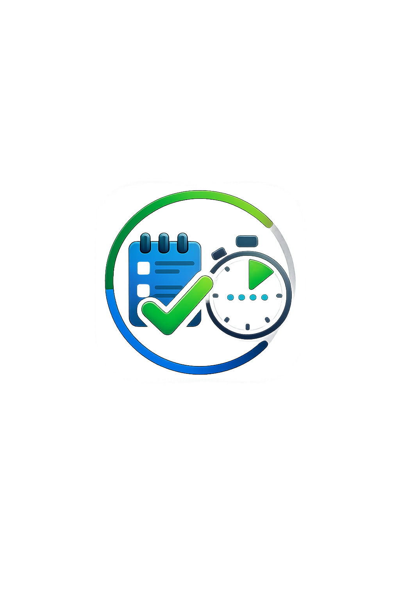

# 📋 Task Manager with Focus Timer

  

  <b>An Android task management application built with Kotlin and Jetpack Compose.</b>

  <a href="https://github.com/RezaHosseini031/TaskManager/tree/main">Current development — v1.1</a>
  ·
  <a href="https://github.com/RezaHosseini031/TaskManager/tree/release/1.0-xml">Original XML version — v1.0</a>

---

## 📌 Project Overview

Task Manager is an Android application designed to help users organize daily tasks and improve productivity with a built-in Focus Timer.

The project uses modern Android development tools and patterns, including **Kotlin, Jetpack Compose, MVVM, Repository Pattern, Room, Hilt, Coroutines, and Flow**. Its development focuses on maintainable code, separation of concerns, and a responsive user interface.

Version **1.1** is a major step forward from the original XML-based **1.0** release. The application UI has been migrated to Jetpack Compose, and the timer implementation has been expanded with background execution and notification support.

## ✨ Features

- ✅ Create, edit, and delete tasks
- 📂 Separate completed and pending tasks
- 🔍 Search tasks
- ↕️ Sort tasks by different criteria
- ⭐ Assign priorities to tasks
- ⏱️ Focus and Break timer
- ⏯️ Timer controls, including start, pause, resume, and restart
- 🔔 Timer notifications and sound alerts
- 🌙 Dark and Light themes
- 📊 Reactive UI state management
- 💾 Local data persistence with Room
- 🧩 Layered architecture with dependency injection

---

## 🆕 What's New in Version 1.1

Version 1.1 evolves the original XML-based application into a Jetpack Compose implementation and improves the Focus Timer integration.

### UI and interface

- Migrated the main application interface from XML layouts to **Jetpack Compose**.
- Rebuilt the UI using **Material 3** components.
- Adopted Compose-based navigation.
- Continued support for dark and light themes.
- Updated UI state handling around ViewModel and reactive state streams.

### Focus Timer

- Expanded the timer implementation to work with both the app UI and Android background components.
- Integrated a foreground service for background timer execution.
- Integrated AlarmManager scheduling for timer completion.
- Added notification and sound alert handling when a timer phase finishes.
- Connected timer controls in the UI with the timer's background components.

### Project structure and development

- Updated the UI and navigation implementation for Compose.
- Continued using Room for local task persistence.
- Used Hilt for dependency injection and Kotlin Coroutines/Flow for asynchronous and reactive operations.
- Added/continued automated ViewModel testing, including a timer phase completion test.

> **Note:** Automated test coverage is still limited and is being expanded. The presence of a test does not mean that every timer lifecycle, Android background restriction, or device-specific behavior has been fully verified.

---

## 📱 Screenshots

| Dark Theme | Light Theme |
|:---:|:---:|
|  |  |

---

## 📥 Download

  

---

## 🧰 Tech Stack

| Category | Technologies |
|---|---|
| Language | Kotlin |
| UI | Jetpack Compose |
| UI Components | Material 3 |
| Architecture | MVVM, Repository Pattern, layered architecture |
| Navigation | Navigation Compose |
| Local Database | Room |
| Dependency Injection | Hilt |
| Asynchronous Programming | Kotlin Coroutines |
| Reactive Data | Kotlin Flow, StateFlow |
| Networking | Retrofit, OkHttp, Gson |
| Data Source | Static JSON |
| Background Work | Android Foreground Service, AlarmManager |
| Version Control | Git, GitHub |

---

## 🏗️ Architecture

The project follows a layered structure that separates UI, ViewModel, repository, and data responsibilities.

- **UI:** Displays application screens using Jetpack Compose and Material 3.
- **ViewModel:** Manages screen state and handles user interactions.
- **Repository:** Separates data operations from ViewModel logic.
- **DAO:** Provides database access through Room.
- **Hilt:** Handles dependency injection.

The project applies architectural principles such as separation of concerns and repository-based data access. It is a layered application; it should not be considered a fully separated Clean Architecture implementation with independent domain and use-case modules.

---

## 🔄 Version History

### Version 1.1 — Jetpack Compose

The current \`main\` branch contains the Compose-based implementation and the latest development changes.

- UI migrated from XML layouts to Jetpack Compose.
- Material 3 and Navigation Compose used for the interface and navigation.
- Focus Timer integration expanded with background service and alarm scheduling.
- Timer completion alert and notification handling integrated with the application.

### Version 1.0 — XML

The original XML-based implementation is preserved in the \`release/1.0-xml\` branch.

- Original XML layout-based UI.
- Baseline task management functionality.
- Original project implementation before the Compose migration.

You can browse both versions:

- **[Version 1.1 — Current main branch](https://github.com/RezaHosseini031/TaskManager/tree/main)**
- **[Version 1.0 — Original XML implementation](https://github.com/RezaHosseini031/TaskManager/tree/release/1.0-xml)**

---

## 🧪 Testing

Automated tests are included in the project, but overall test coverage is still a work in progress.

Current and planned testing areas include:

- ViewModel behavior tests.
- Timer phase and state-transition tests.
- Room DAO tests.
- Repository tests.
- Compose UI tests.
- Background timer and notification behavior across Android versions.

---

## 🚀 Future Improvements

- Expand automated test coverage, especially for timer lifecycle and background execution.
- Improve timer state restoration after process death.
- Review and unify timer completion handling to avoid duplicate alerts.
- Improve documentation with KDoc and useful inline comments.
- Add structured logging.
- Add an architecture diagram.
- Continue improving UI consistency and application performance.

---

## 👨‍💻 Author

**Reza Hosseini**

- GitHub: [RezaHosseini031](https://github.com/RezaHosseini031)

Task Manager is an independent personal project developed to practice and demonstrate Android application development.

---

# 📋 مدیریت کارها با تایمر تمرکز

## 📌 معرفی پروژه

Task Manager یک اپلیکیشن اندرویدی برای مدیریت کارهای روزانه و افزایش بهره‌وری است که در کنار قابلیت مدیریت تسک‌ها، تایمر تمرکز و استراحت نیز دارد.

این پروژه با Kotlin توسعه داده شده و در نسخه فعلی رابط کاربری آن با Jetpack Compose پیاده‌سازی شده است. تمرکز پروژه بر استفاده از ابزارهای مدرن توسعه اندروید، جداسازی مسئولیت‌ها، معماری قابل نگهداری و مدیریت واکنشی وضعیت رابط کاربری است.

نسخه **1.1** نسبت به نسخه اولیه **1.0** تغییر مهمی داشته است: رابط کاربری از XML به Jetpack Compose مهاجرت کرده و پیاده‌سازی تایمر نیز با سرویس پس‌زمینه، زمان‌بندی آلارم و اعلان‌ها گسترش پیدا کرده است.

## ✨ قابلیت‌ها

- ✅ ایجاد، ویرایش و حذف تسک‌ها
- 📂 تفکیک کارهای انجام‌شده و انجام‌نشده
- 🔍 جست‌وجوی تسک‌ها
- ↕️ مرتب‌سازی بر اساس معیارهای مختلف
- ⭐ تعیین اولویت برای تسک‌ها
- ⏱️ تایمر تمرکز و استراحت
- ⏯️ کنترل تایمر شامل شروع، توقف موقت، ادامه و راه‌اندازی مجدد
- 🔔 اعلان‌ها و هشدار صوتی هنگام پایان مرحله تایمر
- 🌙 پشتیبانی از تم تاریک و روشن
- 📊 مدیریت واکنشی وضعیت رابط کاربری
- 💾 ذخیره‌سازی محلی اطلاعات با Room
- 🧩 ساختار لایه‌ای و تزریق وابستگی

---

## 🆕 تغییرات نسخه 1.1

نسخه 1.1 نسبت به نسخه 1.0 فقط یک تغییر ظاهری نیست؛ رابط کاربری برنامه به Jetpack Compose مهاجرت کرده و بخش تایمر نیز با اجزای پس‌زمینه اندروید یکپارچه‌تر شده است.

### رابط کاربری

- مهاجرت رابط کاربری از **XML Layouts** به **Jetpack Compose**.
- بازسازی کامپوننت‌های رابط کاربری با **Material 3**.
- استفاده از Navigation Compose برای ناوبری صفحات.
- ادامه پشتیبانی از تم تاریک و روشن.
- به‌روزرسانی شیوه مدیریت وضعیت رابط کاربری با ViewModel و جریان‌های داده واکنشی.

### تایمر تمرکز

- گسترش پیاده‌سازی تایمر برای هماهنگی با رابط کاربری و اجزای پس‌زمینه اندروید.
- استفاده از Foreground Service برای اجرای تایمر در پس‌زمینه.
- استفاده از AlarmManager برای زمان‌بندی پایان تایمر.
- اضافه شدن یکپارچگی اعلان و هشدار صوتی هنگام پایان مرحله تایمر.
- اتصال کنترل‌های تایمر در رابط کاربری به اجزای پس‌زمینه.

### ساختار و توسعه پروژه

- به‌روزرسانی ساختار رابط کاربری و ناوبری متناسب با Compose.
- ادامه استفاده از Room برای ذخیره‌سازی محلی تسک‌ها.
- استفاده از Hilt برای تزریق وابستگی و Coroutines/Flow برای عملیات ناهمگام و داده‌های واکنشی.
- اضافه شدن و توسعه تست‌های ViewModel، از جمله تست پایان مرحله تمرکز تایمر.

> **توجه:** پوشش تست‌های خودکار هنوز کامل نیست و در حال توسعه است. وجود تست به معنی بررسی کامل تمام حالت‌های چرخه تایمر، محدودیت‌های اجرای پس‌زمینه اندروید یا رفتار برنامه روی همه دستگاه‌ها نیست.

---

## 📱 تصاویر برنامه

| تم تاریک | تم روشن |
|:---:|:---:|
|  |  |

---

## 🧰 تکنولوژی‌های استفاده‌شده

| دسته‌بندی | تکنولوژی‌ها |
|---|---|
| زبان برنامه‌نویسی | Kotlin |
| رابط کاربری | Jetpack Compose |
| کامپوننت‌های رابط کاربری | Material 3 |
| معماری | MVVM، Repository Pattern، معماری لایه‌ای |
| ناوبری | Navigation Compose |
| پایگاه داده محلی | Room |
| تزریق وابستگی | Hilt |
| برنامه‌نویسی ناهمگام | Kotlin Coroutines |
| داده‌های واکنشی | Kotlin Flow، StateFlow |
| ارتباط شبکه | Retrofit، OkHttp، Gson |
| منبع داده | Static JSON |
| اجرای پس‌زمینه | Android Foreground Service، AlarmManager |
| کنترل نسخه | Git، GitHub |

---

## 🏗️ معماری پروژه

پروژه از ساختار لایه‌ای استفاده می‌کند تا مسئولیت‌های رابط کاربری، ViewModel، Repository و دسترسی به داده از یکدیگر جدا باشند.

- **UI:** نمایش صفحات برنامه با Jetpack Compose و Material 3
- **ViewModel:** مدیریت وضعیت صفحه و رویدادهای کاربر
- **Repository:** جداسازی عملیات داده از منطق ViewModel
- **DAO:** دسترسی به پایگاه داده با Room
- **Hilt:** مدیریت تزریق وابستگی‌ها

پروژه از اصولی مانند جداسازی مسئولیت‌ها و استفاده از Repository بهره می‌برد؛ با این حال، ساختار فعلی را نباید یک پیاده‌سازی کامل Clean Architecture با ماژول‌های مستقل Domain و Use Case معرفی کرد.

---

## 🔄 تاریخچه نسخه‌ها

### نسخه 1.1 — Jetpack Compose

شاخه فعلی \`main\` شامل پیاده‌سازی مبتنی بر Compose و آخرین تغییرات توسعه پروژه است.

- مهاجرت رابط کاربری از XML به Jetpack Compose.
- استفاده از Material 3 و Navigation Compose.
- گسترش یکپارچگی تایمر تمرکز با سرویس پس‌زمینه و زمان‌بندی آلارم.
- یکپارچه‌سازی اعلان و هشدار پایان تایمر با برنامه.

### نسخه 1.0 — XML

پیاده‌سازی اولیه مبتنی بر XML در شاخه \`release/1.0-xml\` حفظ شده است.

- رابط کاربری مبتنی بر XML Layouts.
- قابلیت‌های پایه مدیریت تسک‌ها.
- نسخه اولیه پروژه پیش از مهاجرت به Compose.

مشاهده هر دو نسخه:

- **[نسخه 1.1 — شاخه اصلی](https://github.com/RezaHosseini031/TaskManager/tree/main)**
- **[نسخه 1.0 — پیاده‌سازی اولیه XML](https://github.com/RezaHosseini031/TaskManager/tree/release/1.0-xml)**

---

## 🧪 تست‌ها

تست‌های خودکار در پروژه وجود دارند، اما پوشش کلی تست‌ها هنوز کامل نیست و در حال توسعه است.

بخش‌های فعلی و برنامه‌ریزی‌شده برای تست:

- تست رفتار ViewModel
- تست مراحل و تغییر وضعیت تایمر
- تست DAO و عملیات پایگاه داده Room
- تست Repository
- تست رابط کاربری Compose
- بررسی رفتار تایمر پس‌زمینه و اعلان‌ها در نسخه‌های مختلف اندروید

---

## 🚀 برنامه‌های آینده

- گسترش پوشش تست‌های خودکار، به‌خصوص برای چرخه عمر تایمر و اجرای پس‌زمینه.
- بهبود بازیابی وضعیت تایمر پس از بسته‌شدن فرایند برنامه.
- یکپارچه‌سازی مدیریت پایان تایمر برای جلوگیری از اعلان‌های تکراری.
- تکمیل مستندات با KDoc و کامنت‌های کاربردی.
- اضافه کردن سیستم لاگ‌گیری ساختاریافته.
- تکمیل نمودار معماری.
- بهبود هماهنگی رابط کاربری و عملکرد برنامه.

---

## 👨‍💻 توسعه‌دهنده

**Reza Hosseini**

- گیت‌هاب: [RezaHosseini031](https://github.com/RezaHosseini031)

Task Manager یک پروژه شخصی و مستقل برای تمرین و نمایش مهارت‌های توسعه اپلیکیشن اندروید است.
