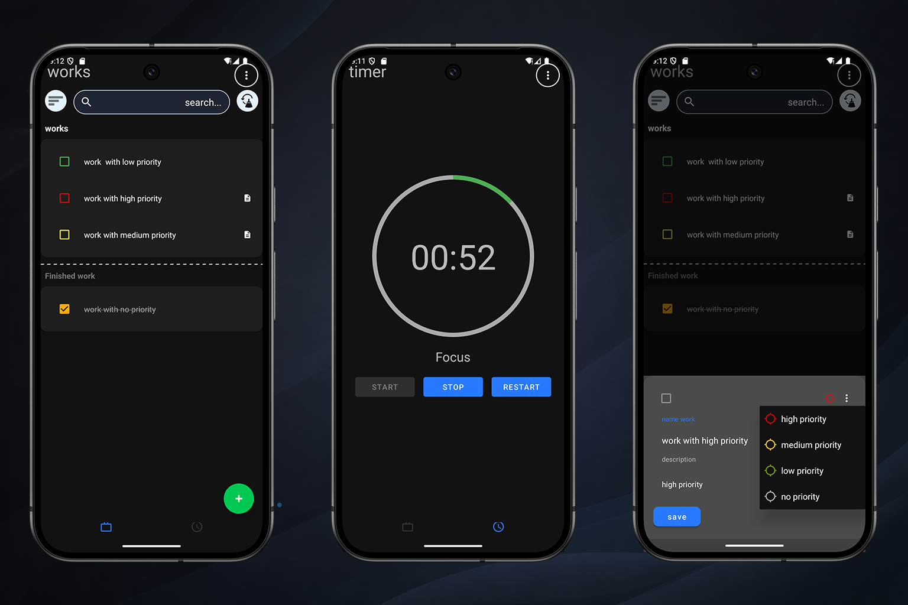
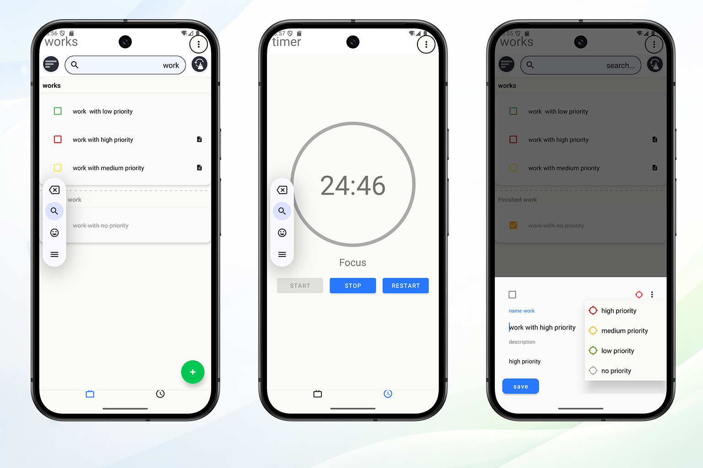
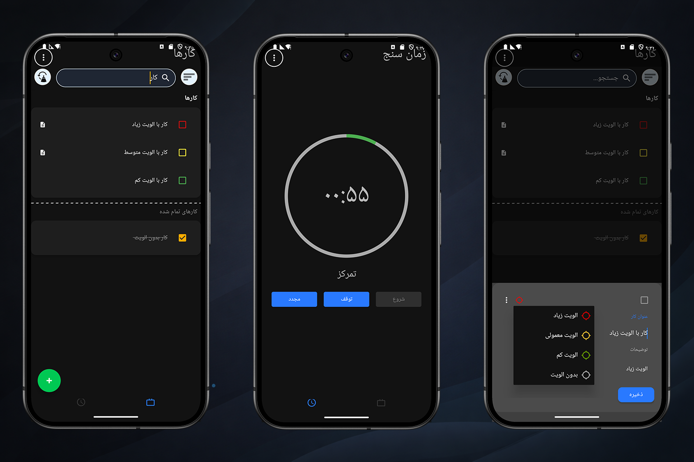

# 📋 Task Manager with Focus Timer

<p align="center">
  
</p>

<p align="center">
  <b>An Android task management application built with Kotlin and Jetpack Compose.</b>
</p>

---

## 📌 Project Overview

Task Manager is an Android application designed to help users organize their daily tasks and improve productivity through a built-in Focus Timer.

The project focuses on modern Android development practices, including **MVVM, Repository Pattern, Clean Architecture principles, reactive state management, and dependency injection**.

The application is built with Kotlin and Jetpack Compose, with an emphasis on maintainable code, separation of concerns, and scalability.

## ✨ Features

- ✅ Create, edit, and delete tasks
- 📂 Separate completed and pending tasks
- 🔍 Search tasks
- ↕️ Sort tasks by different criteria
- ⭐ Assign priorities to tasks
- ⏱️ Focus and Break timer
- 🔔 Notifications and timer sounds
- 🌙 Dark and Light themes
- 📊 Reactive UI state management
- 🧩 Modular and maintainable architecture

---

## 📱 Screenshots

| Dark Theme | Light Theme |
|:---:|:---:|
|  |  |

---

## 📥 Download

<p>
  <a href="https://github.com/RezaHosseini031/TaskManager/tree/main/app/release/app-release.apk">
    
  </a>
</p>

---

## 🧰 Tech Stack

| Category | Technologies |
|---|---|
| Language | Kotlin |
| UI | Jetpack Compose |
| UI Components | Material 3 |
| Architecture | MVVM, Repository Pattern, Clean Architecture principles |
| Navigation | Navigation Compose |
| Local Database | Room |
| Dependency Injection | Hilt |
| Asynchronous Programming | Kotlin Coroutines |
| Reactive Data | Kotlin Flow, StateFlow |
| Networking | Retrofit, OkHttp, Gson |
| Data Source | Static JSON |
| State Management | UiState, StateFlow |
| Version Control | Git, GitHub |

---

## 🏗️ Architecture

The project follows a layered architecture with clear separation between UI, ViewModel, Repository, and data source responsibilities.

```text
        UI Layer
    (Jetpack Compose)
           |
           ▼
      ViewModel
           |
           ▼
      Repository
           |
           ▼
       Data DAO
           |
           ▼
       Room DB
```

- **UI:** Displays application screens using Jetpack Compose and Material 3.
- **ViewModel:** Manages UI state and handles user interactions.
- **Repository:** Separates data operations from the ViewModel.
- **DAO:** Provides database access through Room.
- **Hilt:** Handles dependency injection.

---

## 🔄 Project Evolution

Task Manager was originally developed using **XML layouts**. As the project evolved, its main development branch was migrated to **Jetpack Compose** to adopt a modern declarative UI approach.

The original XML implementation has been preserved in a separate branch.

- **`main`** — The current Jetpack Compose implementation.
- **`release/1.0-xml`** — The original XML-based version (v1.0).

This allows the original implementation to remain available while the main branch continues to evolve with Jetpack Compose.

---

## 🧪 Testing

Automated testing is being developed to improve reliability and maintainability.

Planned test coverage includes:

- Room DAO tests
- Repository tests
- ViewModel tests
- Timer logic tests
- Jetpack Compose UI tests

---

## 🚀 Future Improvements

- Expand automated test coverage.
- Improve documentation with KDoc and inline comments.
- Add Timber for structured logging.
- Add an architecture diagram.
- Improve UI and application performance.
- Expand application features and usability.

---

## 👨‍💻 Author

**Reza Hosseini**

- GitHub: [RezaHosseini031](https://github.com/RezaHosseini031)

Task Manager is an independent personal project developed to practice and demonstrate Android application development.

---

# 📋 مدیریت کارها با تایمر تمرکز

## 📌 معرفی پروژه

Task Manager یک اپلیکیشن اندرویدی برای مدیریت کارهای روزانه و افزایش بهره‌وری است که در کنار قابلیت مدیریت تسک‌ها، از یک تایمر تمرکز و استراحت نیز بهره می‌برد.

این پروژه با Kotlin و Jetpack Compose توسعه داده شده و تمرکز اصلی آن بر استفاده از روش‌های مدرن توسعه اندروید، معماری قابل نگهداری، جداسازی مسئولیت‌ها و مدیریت واکنشی وضعیت رابط کاربری است.

## ✨ قابلیت‌ها

- ✅ ایجاد، ویرایش و حذف تسک‌ها
- 📂 تفکیک کارهای انجام‌شده و انجام‌نشده
- 🔍 جست‌وجوی تسک‌ها
- ↕️ مرتب‌سازی بر اساس معیارهای مختلف
- ⭐ تعیین اولویت برای تسک‌ها
- ⏱️ تایمر تمرکز و استراحت
- 🔔 اعلان‌ها و صداهای تایمر
- 🌙 پشتیبانی از تم تاریک و روشن
- 📊 مدیریت واکنشی وضعیت رابط کاربری
- 🧩 معماری ماژولار و قابل توسعه

---

## 📱 تصاویر برنامه

### 🌙 تم تاریک



---

## 🧰 تکنولوژی‌های استفاده‌شده

| دسته‌بندی | تکنولوژی‌ها |
|---|---|
| زبان برنامه‌نویسی | Kotlin |
| رابط کاربری | Jetpack Compose |
| کامپوننت‌های رابط کاربری | Material 3 |
| معماری | MVVM، Repository Pattern، اصول Clean Architecture |
| ناوبری | Navigation Compose |
| پایگاه داده محلی | Room |
| تزریق وابستگی | Hilt |
| برنامه‌نویسی ناهمگام | Kotlin Coroutines |
| داده‌های واکنشی | Kotlin Flow، StateFlow |
| ارتباط شبکه | Retrofit، OkHttp، Gson |
| منبع داده | Static JSON |
| مدیریت وضعیت | UiState، StateFlow |
| کنترل نسخه | Git، GitHub |

---

## 🏗️ معماری پروژه

پروژه با جداسازی مسئولیت‌ها میان لایه‌های رابط کاربری، ViewModel، Repository و منبع داده طراحی شده است.

```text
        UI Layer
    (Jetpack Compose)
           |
           ▼
      ViewModel
           |
           ▼
      Repository
           |
           ▼
       Data DAO
           |
           ▼
       Room DB
```

- **UI:** نمایش صفحات برنامه با Jetpack Compose و Material 3
- **ViewModel:** مدیریت وضعیت رابط کاربری و رویدادهای کاربر
- **Repository:** جداسازی عملیات داده از ViewModel
- **DAO:** دسترسی به پایگاه داده با Room
- **Hilt:** مدیریت تزریق وابستگی‌ها

---

## 🔄 روند توسعه و مهاجرت به Compose

نسخه اولیه Task Manager با استفاده از **XML Layouts** توسعه داده شده بود. در ادامه، رابط کاربری نسخه اصلی پروژه به **Jetpack Compose** مهاجرت داده شد تا از رویکرد Declarative UI و ابزارهای مدرن توسعه اندروید استفاده شود.

نسخه اولیه XML نیز در یک شاخه جداگانه حفظ شده است:

- **`main`** — نسخه فعلی مبتنی بر Jetpack Compose
- **`release/1.0-xml`** — نسخه اولیه مبتنی بر XML (نسخه 1.0)

به این ترتیب، نسخه قبلی پروژه برای مراجعه و مقایسه در دسترس باقی می‌ماند و توسعه نسخه اصلی روی Compose ادامه پیدا می‌کند.

---

## 🧪 تست‌ها

توسعه تست‌های خودکار پروژه برای افزایش اطمینان از صحت عملکرد و نگهداری بهتر کد در حال انجام است.

بخش‌هایی که برای تست در نظر گرفته شده‌اند:

- تست DAO و عملیات پایگاه داده Room
- تست Repository
- تست ViewModel
- تست منطق تایمر
- تست رابط کاربری Jetpack Compose

---

## 🚀 برنامه‌های آینده

- گسترش پوشش تست‌های خودکار
- تکمیل مستندات با KDoc و کامنت‌های داخل کد
- اضافه کردن Timber برای مدیریت لاگ‌ها
- تکمیل نمودار معماری
- بهبود رابط کاربری و عملکرد برنامه
- توسعه قابلیت‌ها و امکانات جدید

---

## 👨‍💻 توسعه‌دهنده

**Reza Hosseini**

- گیت‌هاب: [RezaHosseini031](https://github.com/RezaHosseini031)

Task Manager یک پروژه شخصی و مستقل برای تمرین و نمایش مهارت‌های توسعه اپلیکیشن اندروید است.